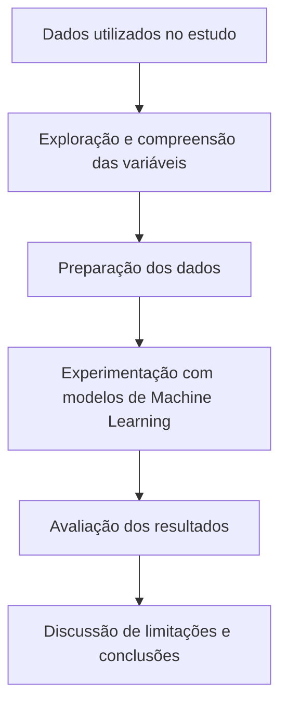

<div align="center">

### Machine Learning aplicado ao estudo da sobrevida no câncer de mama

**Projeto acadêmico · Inteli**

*Investigação de técnicas de aprendizado de máquina para explorar padrões associados à sobrevida de pacientes com câncer de mama.*

[Visão geral](#visão-geral) · [Metodologia](#abordagem-metodológica) · [Experimentos](#experimentos-e-resultados) · [Como explorar](#como-explorar-e-reexecutar) · [Documentação](#documentação) · [Equipe](#equipe)

</div>

## Visão geral

Projeto desenvolvido no contexto acadêmico do **Instituto de Tecnologia e Liderança (Inteli)**, com foco no estudo de modelos preditivos aplicados a um problema relevante da saúde: a complexidade de estimar desfechos de sobrevida em pacientes com câncer de mama.

A evolução de uma doença oncológica depende de múltiplos fatores. Isso torna a interpretação de dados clínicos e a construção de modelos preditivos tarefas que exigem cuidado tanto na preparação dos dados quanto na avaliação dos resultados.

A proposta do projeto é **investigar o uso de Machine Learning para identificar relações e padrões nos dados disponíveis**, documentando experimentos em notebooks Python e reunindo o desenvolvimento em materiais técnicos.

### Problema investigado

Como técnicas de aprendizado de máquina podem contribuir para explorar fatores associados à sobrevida de pacientes com câncer de mama — e quais são as limitações de uma abordagem preditiva baseada em dados?

### Objetivo

Desenvolver e estudar uma abordagem computacional para predição de sobrevida, com ênfase no processo de experimentação, análise dos dados e avaliação crítica das conclusões. **O objetivo acadêmico não implica capacidade comprovada de oferecer previsões confiáveis para pacientes individuais.**

## O que o repositório contém

| Recurso | Conteúdo |
| --- | --- |
| **Notebooks** | Código e registros de execução dos experimentos em Python, organizados na pasta [`notebooks/`](notebooks/). |
| **Documentação** | Materiais de desenvolvimento e relatórios do projeto disponíveis em [`Documentos/`](Documentos/). |
| **README** | Contexto do problema, orientação de navegação, execução e limitações de uso. |

O repositório é voltado à **documentação de um estudo de ciência de dados**. Não há, na estrutura principal exibida, uma aplicação clínica, API de produção ou serviço de inferência implantado.

## Abordagem metodológica

O diagrama apresenta a organização conceitual de uma investigação preditiva. As etapas exatas e os procedimentos empregados devem ser consultados no notebook e nos relatórios do projeto.



### Cuidados metodológicos essenciais

A avaliação de modelos relacionados à sobrevida exige atenção especial a aspectos como:

- **Definição do alvo:** distinguir tempo de sobrevida, sobrevivência em um horizonte específico e outras possíveis variáveis de resposta.
- **Qualidade e origem dos dados:** identificar a procedência do conjunto de dados, os critérios de seleção, as variáveis e as limitações de cobertura.
- **Separação de dados:** evitar que informações de avaliação influenciem o treinamento ou o pré-processamento.
- **Métricas adequadas:** selecionar medidas compatíveis com o tipo de previsão estudado, além de verificar generalização e possíveis vieses.
- **Censura e acompanhamento:** considerar registros sem evento observado ao fim do acompanhamento, caso o problema seja modelado como análise de sobrevivência.

Esses itens são **critérios relevantes para a interpretação do estudo**, não uma afirmação de que todos foram implementados no código original.

## Experimentos e resultados

A principal fonte para examinar os experimentos é a pasta **[`notebooks/`](notebooks/)**, que reúne os Jupyter Notebooks do projeto. Os relatórios complementares estão em **[`Documentos/`](Documentos/)**.

### Como interpretar os resultados

Este README **não atribui uma taxa de acerto, um modelo vencedor nem validação clínica** sem evidências quantitativas confirmadas. Para avaliar o desempenho, é necessário verificar diretamente:

1. Qual variável foi definida como alvo da predição.
2. Quais modelos foram implementados e comparados.
3. Quais conjuntos de dados e estratégias de validação foram usados.
4. Quais métricas foram calculadas e sob quais condições.
5. Quais limitações e riscos de generalização foram identificados.

> **Transparência:** resultados apresentados em notebooks acadêmicos não equivalem, por si só, a desempenho demonstrado em pacientes ou instituições diferentes dos dados utilizados na pesquisa. A eficácia clínica não foi estabelecida por este README.

## Tecnologias e ferramentas

| Área | Tecnologias verificáveis na estrutura e documentação inicial |
| --- | --- |
| **Programação** | Python |
| **Experimentação** | Jupyter Notebook |
| **Ambiente de exploração** | Google Colab, conforme instruções de execução do projeto original |
| **Versionamento e distribuição** | Git e GitHub |

Bibliotecas, algoritmos e versões específicas devem ser conferidos nos imports e no ambiente de execução dos notebooks antes de serem declarados como dependências oficiais do projeto.

## Estrutura do repositório

```text
cancer-predictive-model-ml/
├── Documentos/       # Relatórios e materiais complementares
├── notebooks/        # Notebooks de desenvolvimento e experimentação
└── README.md         # Apresentação e instruções gerais
```

> Esta árvore resume os itens visíveis na raiz do repositório. A organização interna das pastas pode conter diferentes versões de documentos e notebooks.

## Como explorar e reexecutar

### 1. Clonar o repositório

```bash
git clone https://github.com/JacksonAguiar/cancer-predictive-model-ml.git
cd cancer-predictive-model-ml
```

### 2. Localizar o notebook

Abra a pasta [`notebooks/`](notebooks/) e selecione o arquivo Jupyter (`.ipynb`) que deseja analisar. O código e os resultados de execução previamente salvos podem ser inspecionados no próprio GitHub, quando disponíveis.

### 3. Executar no Google Colab

1. Abra o notebook no GitHub.
2. Use a opção **Open in Colab**, quando disponível, ou importe o arquivo `.ipynb` manualmente em [colab.research.google.com](https://colab.research.google.com/).
3. Configure as dependências e disponibilize os dados de entrada eventualmente exigidos pelo notebook.
4. Execute as células na ordem definida pelo estudo e examine os resultados.

**Observação:** reexecutar o notebook depende da disponibilidade dos dados, de versões compatíveis de bibliotecas e de eventuais configurações externas. A existência de saídas salvas no GitHub não garante a reprodução integral do experimento no ambiente atual.

### 4. Consultar o relatório

Acesse [`Documentos/`](Documentos/) para obter detalhes da pesquisa, decisões do desenvolvimento e materiais de apoio produzidos pela equipe.

## Documentação

- **[Repositório no GitHub](https://github.com/JacksonAguiar/cancer-predictive-model-ml)** — código e histórico de desenvolvimento.
- **[Notebooks](notebooks/)** — implementação e registros de experimentação.
- **[Documentos técnicos](Documentos/)** — relatórios e materiais complementares.
- **[Referência original do projeto Connect I.A.](https://github.com/2022M3T4-Inteli/Connect-IA)** — repositório indicado na documentação original.

## Limitações, ética e uso responsável

A interpretação de modelos de saúde exige rigor adicional. Em particular:

- **Uso não clínico:** os experimentos não constituem orientação médica ou recomendação de tratamento.
- **Generalização:** métricas obtidas em uma amostra não demonstram desempenho em outras populações ou contextos clínicos.
- **Viés:** diferenças na origem e na representatividade dos dados podem afetar a validade das conclusões.
- **Privacidade:** conjuntos de dados médicos devem ser tratados conforme as permissões, regras éticas e normas de proteção de dados aplicáveis. Não publique informações identificáveis de pacientes.
- **Reprodutibilidade:** a execução depende dos dados, das dependências e das condições experimentais documentadas.

Para uma eventual evolução além do contexto acadêmico, seriam necessárias etapas adicionais de validação, revisão por especialistas e avaliação regulatória conforme o uso pretendido.

## Equipe

Projeto desenvolvido em 2022, no contexto acadêmico do **Inteli**, pela equipe **Connect I.A.**

- [Dayllan Alho](https://www.linkedin.com/in/dayllan-alho/)
- [Gabriel Caetano](https://www.linkedin.com/in/gabrielcaetanonhoncanse/)
- Henri Harari
- [Oliver Silva](https://www.linkedin.com/in/oliver-gomes-da-silva/)
- [Jordan Andrade](https://www.linkedin.com/in/jordan-andrade-352541240/)
- Jackson Aguiar

Os nomes foram preservados conforme os créditos do README original.

## Referências e contexto

- [Instituto Nacional de Câncer (INCA) — Câncer de mama](https://www.gov.br/inca/pt-br/assuntos/cancer/tipos/mama)
- [Python — documentação oficial](https://docs.python.org/3/)
- [Jupyter — documentação oficial](https://docs.jupyter.org/)
- [Google Colab](https://colab.research.google.com/)

A relação completa das fontes utilizadas na pesquisa deve ser consultada nos documentos originais, que registram o contexto e as referências da época de desenvolvimento.

## Licenciamento e atribuição

O README original apresenta uma referência à licença **[Creative Commons Attribution 4.0 International (CC BY 4.0)](https://creativecommons.org/licenses/by/4.0/)**. Antes de reutilizar ou redistribuir código, notebooks e outros materiais, confirme com os autores **quais arquivos e componentes estão efetivamente abrangidos por esses termos**.

É recomendável manter um arquivo `LICENSE` explícito na raiz do repositório, após confirmar a licença aplicável, distinguindo quando necessário código-fonte, documentação e dados de terceiros.

---

<div align="center">

**Connect I.A. · Inteli**

*Ciência de dados e aprendizado de máquina para investigar um desafio relevante na área da saúde, com compromisso com transparência metodológica e uso responsável.*

</div>
